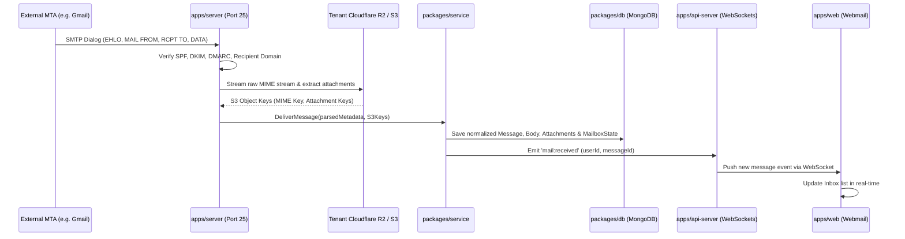

# CellsInbox: System Architecture

**Document Version:** 1.0.0  
**Status:** Active  
**Last Updated:** 2026-11-22  

---

## 1. System Topology Overview

CellsInbox is organized as a **Turborepo Monorepo** separating long-running daemons, APIs, background workers, and frontend applications from shared domain libraries.

```
CellsInbox/
├── apps/
│   ├── server/             # Inbound SMTP daemon (Port 25, STARTTLS)
│   ├── api-server/         # CellsWeb RPC API server + WebSockets
│   ├── queue/              # MTA outbound delivery engine & async queue worker
│   └── web/                # Next.js web application (Webmail + Org Admin + Platform Admin)
├── packages/
│   ├── db/                 # Mongoose connections, models, and indexing
│   ├── schema/             # TypeBox schemas, DTOs, and shared TypeScript interfaces
│   └── service/            # Core business logic & domain services
└── docs/                   # AI continuity & project documentation
```

---

## 2. Process Boundaries & Roles

### `apps/server` (Inbound SMTP Daemon)
- Listens on TCP port 25 (and implicit TLS port 465 if configured).
- Negotiates STARTTLS with host TLS certificates.
- Validates sender domain DNS, SPF records, DKIM signatures, and DMARC alignment.
- Performs recipient validation against local organizations and domains.
- Streams raw RFC 5322 MIME data to the recipient organization's S3/R2 bucket.
- Invokes `packages/service` to persist normalized message metadata and trigger WebSocket delivery events.

### `apps/api-server` (CellsWeb RPC + WebSockets)
- Runs on Node.js using `@cellsweb/rpc-core`.
- High-speed $O(1)$ dispatch with TypeBox runtime validation.
- Serves internal RPC calls for the Next.js web application and external REST/RPC calls for programmatic API key users.
- Manages authenticated WebSocket connection pools per user/organization for instant state updates.

### `apps/queue` (MTA Outbound Worker & Background Jobs)
- Consumes pending jobs from the MongoDB-backed delivery queue.
- Direct-to-MX delivery: Resolves recipient MX records via `node:dns`, establishes outbound SMTP connection on port 25, signs with DKIM, and delivers.
- Fallback Relay: If configured or if direct delivery fails, routes through an upstream relay (e.g. AWS SES).
- Implements exponential backoff retries, bounce handling, and delivery status notifications (DSN).

### `apps/web` (Next.js Webmail & Admin Platform)
- Built on Next.js (App Router).
- Unifies three distinct application contexts:
  1. **Platform Super Admin:** Server metrics, queue monitors, tenant approval workflow.
  2. **Organization Admin:** Domain management, S3/R2 configuration, user management, API keys.
  3. **Webmail Client:** Inbox, conversation threads, rich composer, contacts, calendar, settings.
- Communicates with `apps/api-server` via `@cellsweb/rpc-client` and real-time WebSockets.

---

## 3. Storage Architecture: S3/R2 Offload Flow



---

## 4. Architectural Rules & Invariants

1. **The Service Boundary Rule:**
   - `packages/db` models may NEVER be imported by `apps/server`, `apps/api-server`, `apps/queue`, or `apps/web`.
   - All database reads, writes, and transactions MUST execute through `packages/service`.
2. **Zero Local Disk Blobs:**
   - No user attachments or emails are saved to local server disks. Everything resides in the tenant's S3/R2 bucket to ensure stateless, horizontally scalable application containers.
3. **No Port 587 Submission:**
   - Public port 587 is closed. Programmatic outbound mail is handled via authenticated SendGrid-style API keys over HTTPS.
