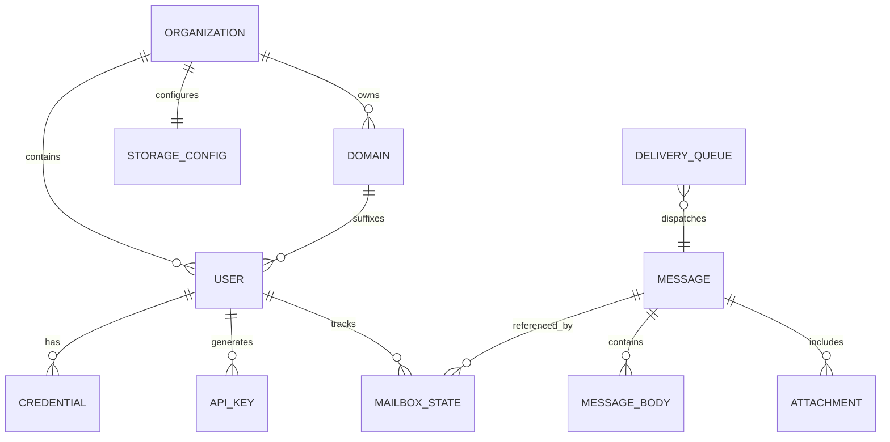

# CellsInbox: Database & Mongoose Schema Architecture

**Document Version:** 1.0.0  
**Status:** Active  
**Last Updated:** 2026-11-22  

---

## 1. Overview & Data Normalization Strategy

CellsInbox utilizes **MongoDB** via **Mongoose** (`packages/db`). 

To avoid the 16MB BSON cap and keep the database fast and cache-friendly:
1. **Raw MIME blobs and binary attachments** are stored in the tenant's BYOS S3/R2 bucket.
2. **Parsed metadata and relational entities** are split across normalized collections linked by `ObjectId` (`ref`).
3. **Per-user mailbox state** (read/unread, starred, folder, labels) is decoupled from immutable message records.

---

## 2. Core Collections & Relationships

---

## 3. Collection Specifications

### 1. `organizations` (Tenants)
- **Purpose:** Represents an enterprise tenant owning domains and users.
- **Fields:**
  - `_id`: ObjectId
  - `name`: String (Required)
  - `slug`: String (Required, Unique, Indexed)
  - `status`: String (`PENDING_APPROVAL`, `ACTIVE`, `SUSPENDED`)
  - `storageConfig`: Subdocument (Encrypted S3/R2 credentials: endpoint, bucket, accessKeyId, secretAccessKey, region)
  - `settings`: Subdocument (Default quotas, sending limits, retention policies)
  - `createdAt`, `updatedAt`: Date

### 2. `domains`
- **Purpose:** Custom email domains managed by an organization.
- **Fields:**
  - `_id`: ObjectId
  - `organizationId`: ObjectId (Ref: `organizations`, Required, Indexed)
  - `name`: String (Required, Unique, Lowercase, Indexed, e.g. `example.com`)
  - `isVerified`: Boolean (Default: false)
  - `verificationToken`: String (TXT record token)
  - `dkimSelector`: String (Default: `ci`)
  - `dkimPrivateKey`: String (Encrypted PEM)
  - `dkimPublicKey`: String (DNS TXT value)
  - `spfStatus`, `dkimStatus`, `dmarcStatus`: String (`VALID`, `INVALID`, `PENDING`)
  - `createdAt`, `updatedAt`: Date

### 3. `users`
- **Purpose:** User accounts (Org Admins and Mailbox Users).
- **Fields:**
  - `_id`: ObjectId
  - `organizationId`: ObjectId (Ref: `organizations`, Required, Indexed)
  - `domainId`: ObjectId (Ref: `domains`, Required, Indexed)
  - `email`: String (Required, Unique, Lowercase, Indexed, e.g. `user@example.com`)
  - `passwordHash`: String (Argon2 / bcrypt)
  - `role`: String (`ORG_ADMIN`, `MAILBOX_USER`)
  - `status`: String (`PENDING_SECURITY_SETUP`, `ACTIVE`, `LOCKED`, `SUSPENDED`)
  - `hasApiPermission`: Boolean (Default: false)
  - `twoFactorEnforced`: Boolean (Default: true)
  - `createdAt`, `updatedAt`: Date

### 4. `credentials` (WebAuthn Passkeys & TOTP)
- **Purpose:** Authentication secrets and multi-factor authenticators.
- **Fields:**
  - `_id`: ObjectId
  - `userId`: ObjectId (Ref: `users`, Required, Indexed)
  - `type`: String (`PASSKEY`, `TOTP`, `RECOVERY_CODE`)
  - `publicKey`: String (For WebAuthn)
  - `credentialId`: String (For WebAuthn, Unique, Indexed)
  - `counter`: Number (For WebAuthn clone detection)
  - `transports`: [String] (e.g. `usb`, `ble`, `internal`)
  - `secret`: String (Encrypted, for TOTP)
  - `createdAt`, `lastUsedAt`: Date

### 5. `api_keys`
- **Purpose:** SendGrid-style API tokens for programmatic sending.
- **Fields:**
  - `_id`: ObjectId
  - `organizationId`: ObjectId (Ref: `organizations`, Required, Indexed)
  - `userId`: ObjectId (Ref: `users`, Required, Indexed)
  - `name`: String (e.g. "Production Mailer")
  - `keyHash`: String (Argon2 / SHA-256 hash, Unique, Indexed)
  - `keyPrefix`: String (e.g. `ci_live_abcd...` for identification)
  - `allowedDomains`: [String] (Specific domains permitted for this key)
  - `rateLimitPerMinute`: Number (Default: 60)
  - `lastUsedAt`: Date
  - `expiresAt`: Date
  - `createdAt`: Date

### 6. `messages` (Immutable Email Metadata)
- **Purpose:** Core metadata for received and sent emails.
- **Fields:**
  - `_id`: ObjectId
  - `organizationId`: ObjectId (Ref: `organizations`, Required, Indexed)
  - `messageId`: String (RFC 5322 Message-ID, Indexed)
  - `inReplyTo`: String (Message-ID reference)
  - `references`: [String] (Thread references)
  - `from`: { name: String, address: String }
  - `to`: [{ name: String, address: String }]
  - `cc`: [{ name: String, address: String }]
  - `bcc`: [{ name: String, address: String }]
  - `subject`: String
  - `date`: Date (Original message date, Indexed)
  - `s3RawKey`: String (S3 object key for raw MIME stream)
  - `sizeBytes`: Number
  - `hasAttachments`: Boolean (Default: false)
  - `spfResult`, `dkimResult`, `dmarcResult`: String (`PASS`, `FAIL`, `NONE`)
  - `createdAt`: Date

### 7. `message_bodies`
- **Purpose:** Extracted text and HTML snippets for rapid rendering.
- **Fields:**
  - `_id`: ObjectId
  - `messageId`: ObjectId (Ref: `messages`, Required, Unique, Indexed)
  - `text`: String (Plain text body)
  - `html`: String (Sanitized HTML body)
  - `snippet`: String (First 150 characters preview)

### 8. `attachments`
- **Purpose:** File attachment metadata linked to S3 objects.
- **Fields:**
  - `_id`: ObjectId
  - `messageId`: ObjectId (Ref: `messages`, Required, Indexed)
  - `filename`: String (Sanitized)
  - `contentType`: String
  - `sizeBytes`: Number
  - `contentId`: String (For inline images)
  - `s3ObjectKey`: String (S3 object key)
  - `createdAt`: Date

### 9. `mailbox_states`
- **Purpose:** Per-user state for a message (folders, read flags, stars).
- **Fields:**
  - `_id`: ObjectId
  - `userId`: ObjectId (Ref: `users`, Required, Indexed)
  - `messageId`: ObjectId (Ref: `messages`, Required, Indexed)
  - `folder`: String (`INBOX`, `SENT`, `DRAFTS`, `TRASH`, `SPAM`, `ARCHIVE`, `CUSTOM`)
  - `customFolderId`: ObjectId (Optional)
  - `isRead`: Boolean (Default: false, Indexed)
  - `isStarred`: Boolean (Default: false, Indexed)
  - `labels`: [String] (User-applied tags)
  - `createdAt`, `updatedAt`: Date

### 10. `delivery_queue`
- **Purpose:** Outbound email queue and retry management.
- **Fields:**
  - `_id`: ObjectId
  - `organizationId`: ObjectId (Ref: `organizations`, Required, Indexed)
  - `messageId`: ObjectId (Ref: `messages`, Required)
  - `recipient`: String (Destination email address)
  - `status`: String (`PENDING`, `IN_PROGRESS`, `FAILED`, `DELIVERED`, `BOUNCED`)
  - `attempts`: Number (Default: 0)
  - `nextAttemptAt`: Date (Indexed)
  - `lastError`: String
  - `smtpResponseCode`: Number
  - `createdAt`, `updatedAt`: Date
